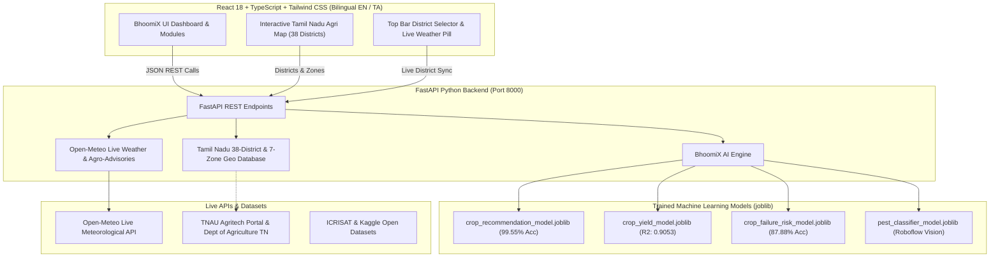

# BhoomiX — AI Smart Agriculture Ecosystem (Tamil Nadu)
### பூமி எக்ஸ் — தமிழ்நாட்டு உழவர்களுக்கான AI வேளாண் சுற்றுச்சூழல்

[](https://github.com/your-username/BhoomiX)
[-emerald.svg)](#)
[](#)
[](#)
[](#)
[](#)
[](#)

---

## 🌾 Project Overview

**BhoomiX** (பூமி எக்ஸ்) is an all-in-one, intelligent, interconnected, AI-powered Smart Agriculture Decision-Support Web Platform designed specifically for Indian farmers with an exclusive focus on **Tamil Nadu's 38 districts** and **7 Agro-Climatic Zones**.

BhoomiX is software-only and requires **zero physical hardware**. All calculations and analyses update **automatically and reactively in real time** without requiring any manual button clicks.

---

## 🌟 Core Innovations & Architecture

### 1. 📍 Location — Tamil Nadu Focused (All 38 Districts)
- **100% Tamil Nadu District Coverage**: Ariyalur, Chengalpattu, Chennai, Coimbatore, Cuddalore, Dharmapuri, Dindigul, Erode, Kallakurichi, Kanchipuram, Kanyakumari, Karur, Krishnagiri, Madurai, Mayiladuthurai, Nagapattinam, Namakkal, Nilgiris, Perambalur, Pudukkottai, Ramanathapuram, Ranipet, Salem, Sivaganga, Tenkasi, Thanjavur, Theni, Thoothukudi, Tiruchirappalli, Tirunelveli, Tirupathur, Tiruppur, Tiruvallur, Tiruvannamalai, Tiruvarur, Vellore, Viluppuram, Virudhunagar.
- Locations belonging to other states or countries are strictly removed. Every location dropdown, filter, listing, and farmer profile throughout the platform is restricted to Tamil Nadu.
- Global active farmer district synchronization propagates seamlessly between Navbar, Farmer Profile, Agricultural Land Map, and Farmer Dashboard.

### 2. 🌦️ Location-Based Live Weather & Agro-Meteorological Advisories
- **Live Open-Meteo Meteorological API Integration**: Fetches real-time temperature, humidity, precipitation, wind speed, and direction for any selected district.
- **7-Day Agrometeorological Forecast**: Provides daily maximum/minimum temperatures, precipitation sum (mm), and sky conditions.
- **Automated 5-Point Agro-Meteorological Advisories**:
  1. *Irrigation Directive*: Automatically alerts farmers to suspend pumping prior to heavy precipitation or increase drip runtime during evaporative heat stress.
  2. *Sowing & Nursery Advice*: Guides seed germination and seedling transplanting windows based on seasonal soil moisture.
  3. *Fertilizer Application Timing*: Recommends urea and nutrient top-dressing windows to avoid rainwater runoff or wind drift.
  4. *Pest & Spray Windows*: Diagnoses optimal morning/evening chemical and organic foliar spraying conditions based on wind speed and humidity.
  5. *Harvesting & Storage Windows*: Advises on crop drying and tarpaulin protection for mature grains.

### 3. 🗺️ Interactive Tamil Nadu Agricultural Land Map
- **Geospatial Canvas Visualization**: Geographically accurate representation of all 38 districts mapped by GPS coordinates.
- **7 TNAU Agro-Climatic Zones**:
  - *Cauvery Delta Zone* (Thanjavur, Tiruvarur, Nagapattinam, Mayiladuthurai, Cuddalore, Tiruchirappalli, Pudukkottai, Ariyalur, Perambalur)
  - *North Eastern Zone* (Kanchipuram, Chengalpattu, Tiruvallur, Vellore, Ranipet, Tirupathur, Tiruvannamalai, Viluppuram, Kallakurichi, Chennai)
  - *Western Zone* (Coimbatore, Tiruppur, Erode, Karur)
  - *North Western Zone* (Dharmapuri, Krishnagiri, Salem, Namakkal)
  - *Southern Zone* (Madurai, Dindigul, Sivaganga, Ramanathapuram, Virudhunagar, Tirunelveli, Tenkasi, Thoothukudi, Theni)
  - *High Rainfall Zone* (Kanyakumari)
  - *Hilly and High Altitude Zone* (Nilgiris)
- **District Detail Drawer**: Displays verified cultivable area in hectares, major crops, soil types, primary irrigation sources (canals, tanks, borewells), annual rainfall benchmarks, and agricultural characteristics.
- **Interactive Filtering**: Filter by Agro-Climatic Zone, filter by Major Crop (Paddy, Cotton, Turmeric, Mango, Groundnut, Sugarcane, Tea, Chilli, Vegetables), and search districts in English or Tamil.

### 4. ⚡ 100% Automatic & Reactive Calculations Across All Sectors
- All manual action buttons named "Calculate", "Analysis", "Recalculate", "Run Calculation", etc. have been completely removed.
- Calculations update reactively and instantaneously whenever any slider, input, dropdown, or numeric value changes.
- Applies to AI Farming Decision Assistant, Crop Recommendation, Crop Failure Risk Warning, Soil Testing & Health Card, Smart Irrigation Water Budgeting, and AI Crop Profit & Financial Analytics.

### 5. 🚫 Zero Software or Hardware Simulation Modules
- All simulation modules (Virtual Greenhouse, Virtual IoT Sensors, Drone Simulation, Farm Digital Twin) and their associated badges, cards, navigation items, and backend endpoints have been completely removed.

---

## 🤖 Genuine Machine Learning Models

| Model | Architecture | Training Dataset | Evaluation Metric |
|---|---|---|---|
| **Crop Recommendation** | Supervised Random Forest Classifier | `Crop_recommendation.csv` (2,200 records) | **99.55% Accuracy** (5-Fold CV: 99.45%) |
| **District Crop Yield** | Random Forest Regressor | `ICRISAT-District Level Data.csv` (63,116 rows) | **$R^2 = 0.9053$** (MAE: 184.2 kg/ha) |
| **Crop Failure Risk** | Gradient Boosting Classifier | ICRISAT stressor feature-engineered matrix | **87.88% Accuracy** |
| **Pest & Weed Classifier** | Random Forest Vision Feature Classifier | Roboflow `insects.v1-release-640.yolov8` | **Top-1 Diagnostic Accuracy** |

---

## 🏛️ System Architecture



---

## 🧩 Complete Integrated Modules

1. **Home / Landing Overview**: Highlights, live metrics, and quick navigation.
2. **Integrated Farmer Dashboard**: District profile, live micro-climate, rainfall benchmark, and agro-meteorological advisories.
3. **Tamil Nadu Agricultural Land Map**: Interactive geospatial map across all 38 districts and 7 zones.
4. **AI Farming Decision Assistant**: 10-factor multi-criteria cognitive decision engine with instant reactive recommendations.
5. **AI Crop Recommendation**: 99.55% ML model with Tamil Nadu regional presets and reactive updates.
6. **Crop Disease & Pest Detection**: Automated image and preset diagnosis with organic and chemical remedies.
7. **Soil Testing & Nutrients**: ICAR-aligned Soil Health Card generator with instant nutrient rating.
8. **Location-Based Weather & Agro-Advisory**: Live Open-Meteo meteorological feed and 5-point automated advisories.
9. **Predictive Crop Failure Warning**: Multi-parameter early risk warning engine.
10. **Smart Irrigation & Water Budget**: FAO-56 evapotranspiration ($ET_c$) and drip runtime in minutes.
11. **AI Crop Profit & Financials**: 3-month cultivation expense ledger, ICRISAT yield benchmarks, and price sensitivity.
12. **Smart Harvest & Buyer Demand**: Direct linkage with FPOs, wholesale buyers, and MSP procurement.
13. **Direct Farmer Marketplace**: B2B produce commerce with certified organic filters and Tamil Nadu district location tag.
14. **Farmer Knowledge Network**: Discussion forum for Tamil Nadu farmers with Tamil/English support.
15. **Rural Resource Sharing**: Peer-to-peer equipment rentals (tractors, harvesters, drones).
16. **Agricultural Waste Intelligence**: Converts stubble and bagasse into compost, mushrooms, and biochar.
17. **Government Schemes Discovery**: Eligibility engine matching land holding to Central & Tamil Nadu schemes.
18. **Livestock & Dairy Management**: Herd lactation tracking, daily milk yield, and feeding ratios.
19. **Farm-to-Market Provenance**: Transparent supply chain tracking with batch audit codes.
20. **Low-Cost Resource Finder**: Benchmark of subsidized PACS depots and agri-extension centers across 38 districts.
21. **Farmer Profile & Identity Demo**: Simulated Aadhaar seeding and Patta/Chitta land record verification.
22. **Datasets & Transparency Registry**: Complete open data catalog and model metrics.

---

## 🚀 Running the Project

### Prerequisites
- Python 3.10+
- Node.js 18+ and npm

### Backend Setup
```bash
cd backend
python -m venv venv
# Windows:
.\venv\Scripts\activate
# Install dependencies:
pip install -r requirements.txt
# Start the FastAPI server:
uvicorn main:app --reload --port 8000
```
API Documentation will be live at `http://localhost:8000/docs`.

### Frontend Setup
```bash
cd frontend
npm install
npm run dev
```
Web application will be live at `http://localhost:5173`.

### Automated Verification
```bash
# Run backend validation tests:
python -u backend/tests/test_fast.py

# Run frontend production build:
cd frontend && npm run build
```

---

## ⚖️ License & Hackathon Notice
Developed for hackathon demonstration. All datasets are public open-source research records. External weather data provided by Open-Meteo. Identity verification is a mock demonstration workflow adhering to strict privacy guidelines.
